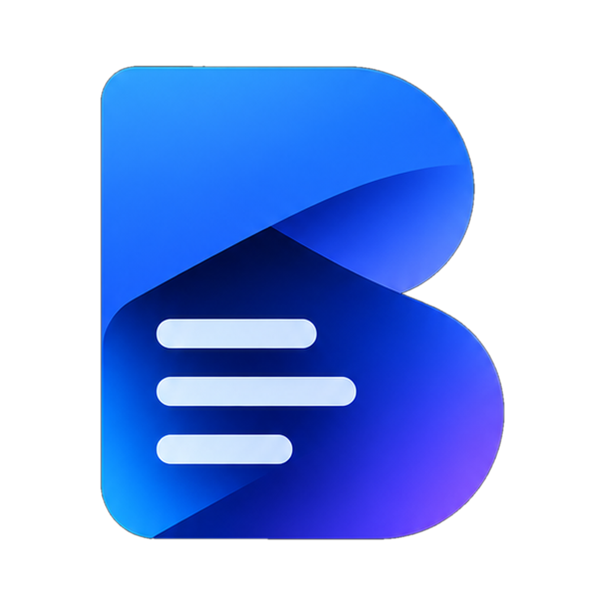
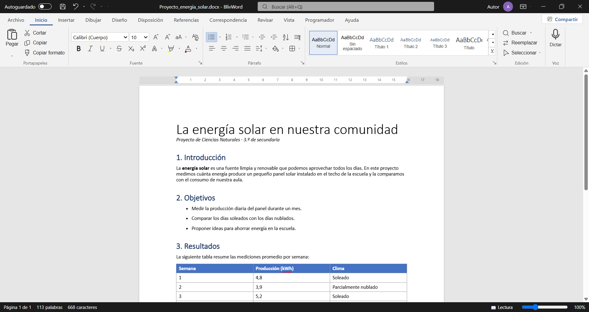
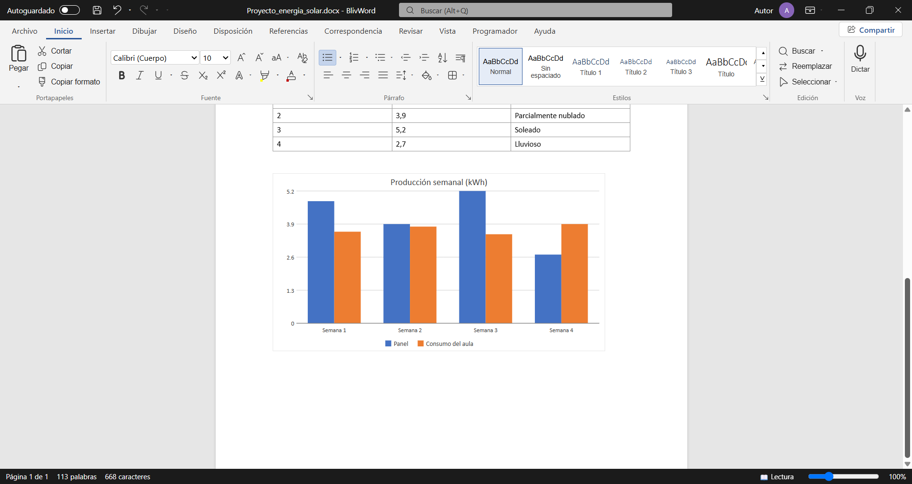
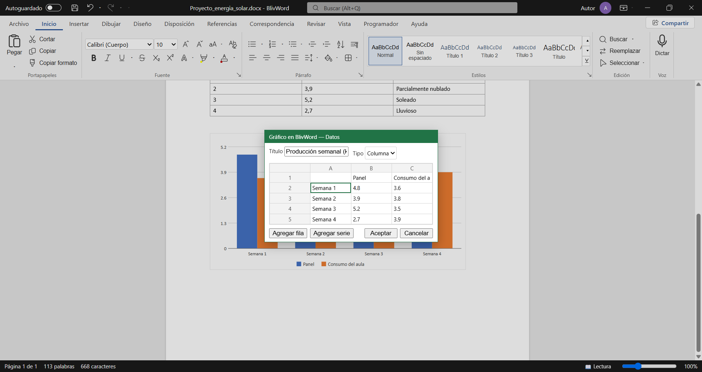
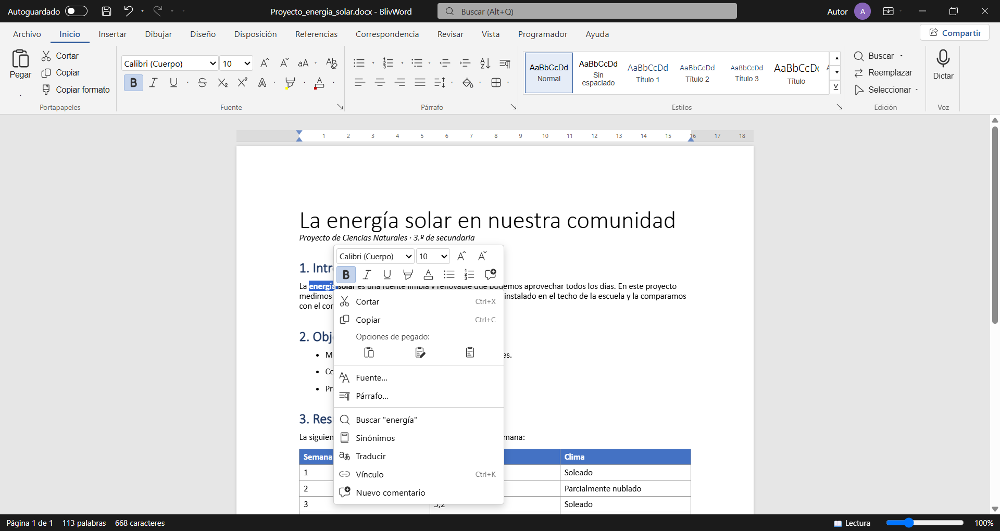
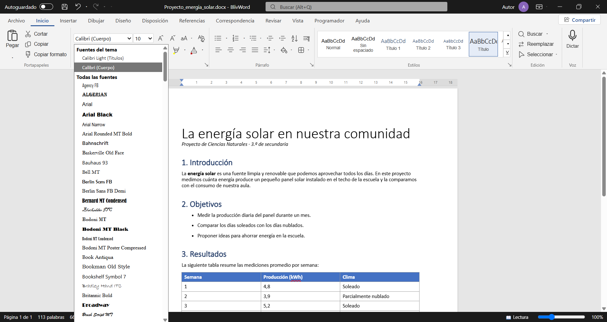

# BlivWord

### Un procesador de textos gratis, en español y que funciona sin internet

Escribe trabajos, informes y documentos con una interfaz que ya conoces, abre los archivos de Word que te envían y guárdalos en el mismo formato. Sin suscripciones y sin crear cuentas.

 

---

## ¿Por qué BlivWord?

| | |
|---|---|
| 💸 **Gratis de verdad** | Sin suscripción mensual, sin periodo de prueba y sin funciones bloqueadas. |
| 🧭 **Te sientes en casa** | Pestañas, cinta de opciones, estilos y menús organizados como en el procesador de textos que ya usas. No tienes que aprender nada nuevo. |
| 📴 **Funciona sin internet** | Todo ocurre en tu computadora. Escribe en clase, en el bus o donde no haya wifi. |
| 🔒 **Tus documentos son tuyos** | No hace falta iniciar sesión y tus archivos no se suben a ningún servidor. |
| 🪶 **Ligero** | El instalador pesa unos 9 MB y abre en segundos, incluso en computadoras modestas. |
| 🔄 **Siempre al día** | Las nuevas versiones llegan solas: la aplicación te avisa y se actualiza con un clic. |
| 🇪🇸 **Hecho en español** | Interfaz, revisión ortográfica, gramática, sinónimos y ayuda pensados para hispanohablantes. |

## Abre y guarda los archivos de siempre

**Word (.docx)** · **Word 97‑2003 (.doc)** · **PDF** · **OpenDocument (.odt)** · **RTF** · **HTML** · **Texto (.txt)**

Recibes un trabajo en Word, lo abres en BlivWord, lo editas y lo devuelves en .docx: tu profesor o tu equipo lo abrirán sin problemas en Microsoft Word. ¿Te mandaron un PDF? BlivWord lo convierte en un documento que puedes editar.

## Todo lo que necesitas para tus trabajos

<table>
<tr>
<td width="50%" valign="top">

**✍️ Escritura y formato**
- Todas las fuentes instaladas en tu computadora
- Estilos, títulos, listas y numeración
- Interlineado, sangrías y columnas
- Encabezados, pies y números de página
- Portadas y plantillas

**🎓 Trabajos académicos**
- Citas y bibliografía en **APA** y **MLA**
- Tabla de contenido automática
- Notas al pie y al final
- Títulos de figuras y tablas
- Editor de ecuaciones

</td>
<td width="50%" valign="top">

**📊 Contenido visual**
- Tablas con estilos
- Gráficos de columnas, líneas y circulares
- Imágenes, formas y SmartArt
- Dibujo a mano alzada

**✅ Revisión**
- Ortografía, gramática y estilo
- Contador de palabras
- Comentarios y control de cambios
- Sinónimos y traducción
- Dictado por voz y lectura en voz alta
- Exportar a **PDF** e imprimir

</td>
</tr>
</table>

## Capturas

<table>
<tr>
<td width="50%"> <b>Gráficos</b> con varias series que también se pueden editar en Microsoft Word.</td>
<td width="50%"> <b>Datos del gráfico</b> en una hoja sencilla: cambia los números y el gráfico se actualiza.</td>
</tr>
<tr>
<td width="50%"> <b>Clic derecho</b> con minibarra de formato, opciones de pegado, sinónimos y traducción.</td>
<td width="50%"> <b>Todas tus fuentes</b>, cada una con su propio estilo para elegir de un vistazo.</td>
</tr>
</table>

## BlivWord frente a otras opciones

| | **BlivWord** | Microsoft Word | Google Docs | LibreOffice Writer |
|---|:---:|:---:|:---:|:---:|
| Precio | ✅ Gratis | 💳 Suscripción o licencia | ✅ Gratis | ✅ Gratis |
| Sin crear una cuenta | ✅ | ❌ Cuenta Microsoft | ❌ Cuenta Google | ✅ |
| Funciona sin internet | ✅ | ✅ | ⚠️ Requiere configurarlo | ✅ |
| Interfaz de cinta como Word | ✅ | ✅ | ❌ | ⚠️ Distinta por defecto |
| Abre y guarda .docx | ✅ | ✅ | ✅ | ✅ |
| Abre PDF para editarlo | ✅ | ✅ | ⚠️ Con Google Drive | ⚠️ Con Draw |
| Tamaño de descarga | ✅ ~9 MB | Varios GB (suite Office) | — (navegador) | ~350 MB |
| Documentos solo en tu equipo | ✅ | ⚠️ Promueve OneDrive | ❌ En la nube | ✅ |

> BlivWord no busca reemplazar todas las funciones avanzadas de una suite de oficina profesional; está pensado para quien quiere escribir y entregar documentos compatibles con Word **sin pagar y sin complicaciones**.

## Instalación

1. Descarga **`BlivWord_x.y.z_x64-setup.exe`** desde la [última versión](https://github.com/blivcodesolution-png/BlivWord/releases/latest).
2. Ábrelo y sigue el asistente. No necesitas permisos de administrador.
3. ¡Listo! Los archivos .docx, .doc, .odt y .rtf se pueden abrir con doble clic.

<b>Windows muestra un aviso al descargar o abrir el instalador</b>

 

BlivWord todavía no tiene un certificado de firma de código de pago, por eso Windows lo trata como una aplicación "poco conocida". Es normal en aplicaciones nuevas e independientes.

- **En el navegador** (Edge/Chrome): abre las descargas, pasa el cursor por el archivo y elige **⋯ → Conservar**.
- **En Windows SmartScreen**: haz clic en **Más información → Ejecutar de todas formas**.

Descarga BlivWord solo desde esta página oficial de GitHub.

### Requisitos

- Windows 10 u 11 de 64 bits
- WebView2 (ya viene incluido en Windows 11 y en Windows 10 actualizado; el instalador lo agrega si falta)

## Novedades

Consulta los cambios de cada versión en la página de [Releases](https://github.com/blivcodesolution-png/BlivWord/releases). Las actualizaciones llegan automáticamente a la aplicación.

## Ayuda y sugerencias

¿Encontraste un error o tienes una idea? Abre un [issue](https://github.com/blivcodesolution-png/BlivWord/issues) y cuéntanos qué pasó. Tus comentarios deciden qué mejoramos primero.

---

Hecho con ❤️ por **blivcode**

Microsoft Word, Google Docs y LibreOffice son marcas de sus respectivos propietarios. BlivWord es un producto independiente y no está afiliado a ellos.

